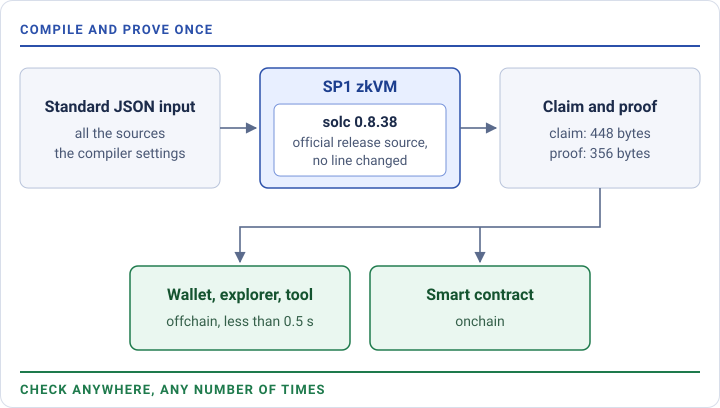

When a block explorer shows a green check mark next to a contract, what do you actually know?

You know that a server compiled some source code and says the result is the same as the code onchain. You didn't see the compilation yourself, so in the end you are trusting the server.

We run one of these servers. Sourcify is fully open source and open data so anyone can check our work, but checking a verification today means doing the whole compilation again. Most people never do it, and a smart contract can't do it at all.

So we tried something different: we ran the Solidity compiler inside a zero-knowledge virtual machine (zkVM). What comes out is a 356 byte proof that the official solc 0.8.38 compiled a given source code into the code at a given address. Anyone can check this proof in less than half a second without compiling anything, and so can a contract.

{/* truncate */}

:::info
This is an experiment, not a product. It works for a single compiler version and we made a real proof for one small contract on Sepolia. You can find the code at [sourcifyeth/solc-zk-proof](https://github.com/sourcifyeth/solc-zk-proof).
:::

## The problem: a verification is a statement, not a proof

[Source code verification](/blog/technical-verification-walkthrough/) is simple at its core: you take the source code, compile it with the same compiler and settings, and compare the result with the bytecode onchain.

What you get at the end of all this work is a single field in a database: `exact_match`. Now if you want to rely on that field, you have two options.

**Option 1: Trust the verifier.** This is what most wallets, explorers and tools do, i.e. they call an API and show the answer. Keep in mind that the most used verifier is closed source, so there you can't even look at the code that made the decision.

**Option 2: Compile it yourself.** [lib-sourcify](/docs/lib-sourcify/) runs in the browser and Otterscan uses it for its "Verify locally" button. [Onay](/blog/onay-local-signing-companion/) does the same before you sign a transaction. This removes the trust but it comes at a price: you need the exact compiler version of the contract (the Linux binary of solc 0.8.38 alone is 15 MB, and every contract can ask for a different one), you need all the source files, and you need to wait for the compilation, which takes less than a second for a small contract but can take minutes for a large project.

This is fine on a laptop, but not everyone who needs the answer is sitting in front of one:

- **A hardware wallet** has a small processor, little memory and no network, so compiling there is out of the question.
- **A smart contract** can read the code hash of another contract but it can't run a compiler. So there is simply no way to ask onchain "is the code at this address the compilation of that source?"

## The idea: prove the compilation once

A zkVM is a virtual machine that runs a normal program and, on top of the result, gives you a small proof that this exact program gave this output for this input. Checking the proof is much cheaper than running the program again, no matter how long the program ran.

Now imagine the program is the compiler. The input is the source code, the output is the hash of the bytecode, and the proof says solc compiled this source into this bytecode. Someone compiles once inside the zkVM, and from then on everyone just checks the proof instead of compiling.



By the way, "zero-knowledge" means that a proof can hide its input. We have nothing to hide here since the source code is public (that's the whole point of verification). What we are after is the other property of these proofs: they are small and quick to check.

This idea is not ours. In February 2026 Javier Ron and Martin Monperrus [did the same with a C compiler](https://arxiv.org/abs/2602.11887), but we couldn't find a public project doing it with solc.

## The experiment

We used [SP1](https://github.com/succinctlabs/sp1), Succinct's zkVM. These are roughly the steps:

1. **Input:** The [standard JSON input](https://docs.soliditylang.org/en/latest/using-the-compiler.html#input-description) of the contract, i.e. all the sources and the compiler settings. Sourcify already stores this for every verified contract, so there's nothing new to collect.
2. **Compile in the zkVM:** The zkVM program is solc itself, built from the official release source for the RISC-V processor of the zkVM. We didn't change a single line of solc, because otherwise the proof would be about "solc with our patches" and you would have to trust our patches. The program calls `solidity_compile` on the input, which is the same entry point solc-js uses.
3. **Prove:** The program outputs a small record that we call the claim, and SP1 makes a Groth16 proof (a proof format that is cheap to check on Ethereum) that this exact program gave this claim for this input.
4. **Check:** Whoever wants to check verifies the proof and then compares the hashes in the claim with the bytecode that is actually deployed at the contract's address. Offchain, a tool fetches this bytecode from any Ethereum RPC with `eth_getCode`. Onchain, a smart contract can do the same check, since it can read the bytecode at an address directly.

The claim contains the hash of the input, the compiler version, the contract name and the hashes of the bytecode. It also contains the positions of the [immutables](/docs/immutables/), because these are set by the constructor at deployment and the compiler can't know their values. The checker zeroes these positions in the deployed code before comparing the hashes.

This has a nice side effect: **one proof covers every deployment of the same compilation.** The claim is about the code and not about an address, so if there are ten thousand copies of a token contract with the same code, a single proof covers all of them.

For the example we deployed a small `Counter` contract on Sepolia, compiled with solc 0.8.38 and [verified on Sourcify](https://repo.sourcify.dev/11155111/0xffD6151Be39D250058911ffcbdb227d4274D40E4). Below is the check a wallet would do (hashes shortened to fit the page):

```
$ solc-zk-proof verify examples/sepolia-counter --rpc $RPC
The Groth16 proof is valid for program 0x00968b…1306a2 (389.7ms).
Claim: {
  "inputHash": "0xc878a8…82bbda",
  "compilerVersion": "0.8.38+commit.1835d247",
  "contractName": "src/Counter.sol:Counter",
  "creationCodeHash": "0xf28e5a…aaf3ff",
  "runtimeCodeHash": "0x654072…bf3b6a",
  "runtimeCodeLength": 481,
  "immutables": [],
  "metadataHash": "0x134964…06c204"
}
The code at 0xffD615…4D40E4 matches the claim.
```

Notice that no compiler ran in this check. And here are the numbers:

| What | Result |
| --- | --- |
| Compile in the zkVM, without a proof | 12,972,840 cycles, a few seconds |
| Make the proof on the Succinct prover network | 30 to 90 seconds, about 0.40 PROVE (about €0.07 in November 2026) |
| Size of the proof | 356 bytes |
| Check offchain | Less than 0.5 seconds |
| Check onchain (`verifyProof`), once per compilation | About 262,000 gas |

A cycle is one instruction of the zkVM's processor, and the more cycles a compilation takes the more expensive its proof gets. The gas is not paid on every check: a contract can check a proof once and store the result, so after that any other contract gets the answer with a simple storage read. We built exactly this, see the next section.

Keep in mind that this is an experiment and it has its limits:

- **One compiler version:** Each solc version is a different zkVM program and we only built solc 0.8.38. The versions are quite concentrated though: in a 1% sample of the Sourcify database the 20 most used versions cover around 83% of the compilations we could prove.
- **Exact matches only:** The deployed code has to be equal to the compiler output byte for byte, except for the immutables. So the contract needs an [exact match](/docs/exact-match-vs-match/) with its libraries linked at compile time, which is the case for around 2.65 million of the roughly 6 million distinct compilations in our database (estimated from the same sample). To cover the rest, the zkVM program could apply Sourcify's [transformations](/docs/transformations/) after compiling, but these live in lib-sourcify (TypeScript) and we would have to port them to Rust first.

## A contract that asks where another contract comes from

This is the part you simply can't do without a proof. We wrote a contract called `ProvenanceRegistry` that keeps a record of which deployed code is proven to come from which source, i.e. its provenance. It has a function that anyone can call:

```solidity
function register(
    address target,
    bytes calldata publicValues,
    bytes calldata proofBytes
) external returns (bytes32 codehash);
```

It checks the proof with Succinct's verifier contract, then reads the code at `target`, zeroes the immutables and compares the hash with the claim. If everything passes, it stores the claim under the code hash. The function doesn't need any access control, since the registry only accepts valid proofs that match the deployed code.

From then on any contract can read the result. Here is the core of `ProvenanceGate`, our example consumer (shortened):

```solidity
function forward(address target, bytes calldata data)
    external
    returns (bytes memory result)
{
    bytes32 inputHash = registry.provenanceOf(target).inputHash;
    if (inputHash != approvedInputHash) revert NotApproved(target);
    // ... forward the call to the target
}
```

The gate knows a single `inputHash` and forwards calls only to contracts whose code is proven to come from that input. In other words, **the gate approves a source, not an address**: a fresh deployment of the same source passes and anything else reverts. Both contracts are on Sepolia, see the [registry](https://repo.sourcify.dev/11155111/0xEa0216F705d9d4d1FA4E77d2b0D303eaA9bFA070) and the [gate](https://repo.sourcify.dev/11155111/0xfa796BCa39942657C92e3ED772c8D988ED5f3882).

### Where could this be useful?

For every idea we asked ourselves "why not just compile again?", because if you can, the proof doesn't add much. These are the ones that survived:

- **Upgrade guards:** A DAO votes on a source instead of an address that someone claims is the right one, and the proxy admin only accepts a new implementation if its code is proven to come from the approved input.
- **Audits bound to the code:** An auditor signs the `inputHash` of the source they reviewed, and anyone (or any contract) can check that a deployment is exactly that source.
- **Wallets on small devices:** Onay compiles on your computer, but a phone could just check a proof for each contract the transaction touches without compiling anything. We haven't tested this.
- **Datasets that prove themselves:** Our [dataset export](/docs/repository/download-dataset/) and the Verifier Alliance database are basically lists of statements from verifiers. With a proof next to each row, someone mirroring the data wouldn't need to trust the verifier that wrote the row.

## What you still trust

A proof doesn't make trust disappear, it just moves it to fewer places:

1. **The proof system:** SP1, its Groth16 circuit with the trusted setup, and the verifier contract. If there's a bug there, everything built on top of it breaks.
2. **The program key:** The proof is about the program `0x0096…06a2`, but who says this program is really solc 0.8.38? The answer is a reproducible build: the build script downloads the official release source, checks its hash, uses pinned tools, and gives the same key regardless of the folder or the user. So anyone can run it and compare the key, and this needs to be done once per compiler version instead of once per contract. That said, someone other than us has to do it and nobody has yet.
3. **The compiler:** The proof says solc gave this output, not that solc is correct. A compiler bug gets a valid proof too, which is no different from today.
4. **The source:** As always, verified does not mean safe. A proof for a malicious source is still a valid proof.
5. **The storage of the source:** The claim only has the hash of the input, so someone still has to keep the input and give it to you, e.g. Sourcify, another verifier, or IPFS. This means a proof doesn't replace a verifier, it only removes the need to trust the verifier for the compilation step.

## The price problem

The Counter is the smallest job you can think of, so we also ran larger contracts in the zkVM without making a proof (which is free) and counted the cycles:

| Contract | Cycles | Estimated price on the prover network |
| --- | --- | --- |
| Counter, 1 source file | 13 million | €0.07 (the price we paid) |
| The median contract of the sample, 7 source files | 155 million | €0.43 to €0.80 |
| Large projects, 49 to 107 source files | 2.9 to 6.7 billion | €7 to €34 |
| Large projects with `viaIR`, 36 to 40 source files | 15.9 to 27.7 billion | €42 to €142 |

Only the first price is real, the rest are estimates we got by scaling the price of the Counter proof with the number of cycles. Still, the picture is clear: a proof for a typical contract costs less than a euro, whereas a proof for a large project can go above 100 euros.

At these prices we can't do this massively, i.e. make a proof for every contract that gets verified on Sourcify. What we can think of instead is offering proofs for specific contracts with special needs: the new implementation behind a governance upgrade, a contract that an auditor signed off, or any contract that another contract has to check onchain. For these, a few euros (or even a hundred) per proof is a small price compared to what is at stake.

## Would you use such a proof?

This was a side experiment and it's not on our roadmap. We don't want to build a service before knowing that someone actually needs it, so we have one question for you:

**Would you use such a proof?** In a wallet, in a governance process, in an audit report? What would you build if a contract could ask where another contract comes from?

Let us know by opening an issue on [sourcifyeth/solc-zk-proof](https://github.com/sourcifyeth/solc-zk-proof), on [X](https://x.com/SourcifyEth), or in our [Matrix chat](https://matrix.to/#/#ethereum_source-verify:gitter.im).
